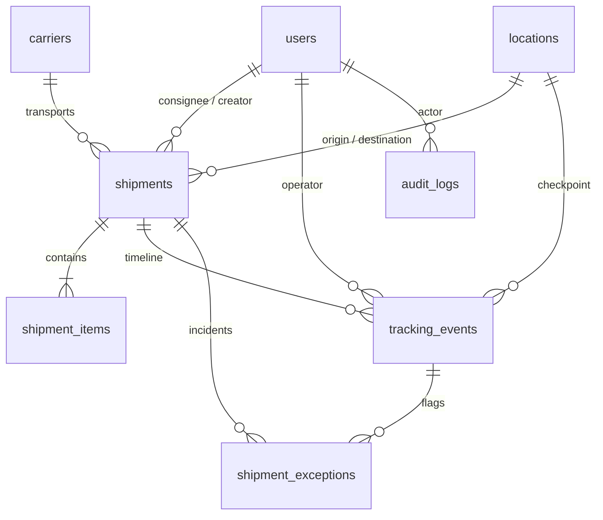

# ❄️ CargoPharma — Global Cold-Chain Vaccine & Pharma Visibility Platform

[](https://laravel.com)
[](https://php.net)
[](https://mysql.com)
[](https://tailwindcss.com)
[](#automated-testing)

> **Web Programming 2 — Final Project (UAS)**  
> *A high-reliability software portfolio engineering project adhering to enterprise cold-chain biopharmaceutical standards.*

---

## 📌 Executive Summary & Problem Domain

### The Challenge
International biopharmaceutical distribution demands rigorous temperature control (*cold-chain logistics*). Vaccines such as the **Novel Oral Polio Vaccine Type 2 (nOPV2)** degrade rapidly if exposed to ambient heat exceeding $-15^\circ\text{C}$ or if transit hubs suffer unmonitored delays. Traditional logistics portals often decouple tracking from real-time environmental telemetry, leaving consignees blind to critical temperature excursions.

### The CargoPharma Solution
**CargoPharma** is a mission-critical visibility and monitoring platform built upon a real-world industrial case study: **PT Bio Farma (Persero)**, Indonesia's state-owned vaccine manufacturer supplying ~70% of global polio vaccines under **WHO & UNICEF** mandates.

Key capabilities:
- **Strict State Machine Lifecycle:** Deterministic transition validation (`CREATED` → `BOOKED` → `PICKED_UP` → `IN_TRANSIT` → `DELIVERED`). Terminal delivery state locking.
- **Automated Delay & Severity Rules:** Real-time delay calculation with cold-chain risk classifications (`NONE`, `LOW`, `MEDIUM`, `HIGH`).
- **Geospatial Corridor Mapping:** Interactive **Leaflet.js + OpenStreetMap** tracking with temperature badges and flight paths.
- **External Atmospheric Telemetry:** Integration with **OpenWeather API** to assess tarmac heatwave risks at transit hubs (e.g., Dubai DXB at $42.8^\circ\text{C}$).
- **Role-Based Access Control (RBAC):** Server-enforced permissions for Administrators, Logistics Operators, and Consignee Customers.
- **RESTful API Contract:** Full Sanctum-authenticated JSON API for mobile and partner integrations.

---

## 🏗️ Architectural Pattern (Service Layer)

Following enterprise architectural best practices, business rules and telemetry processing are decoupled from HTTP controllers into dedicated **Service Classes**:

```text
app/
├── Http/
│   ├── Controllers/
│   │   ├── Api/          # Sanctum-authenticated JSON REST endpoints
│   │   └── Web/          # Mission Control Web Controllers
│   ├── Middleware/       # Role authorization & session guards
├── Services/             # CORE BUSINESS ENGINE
│   ├── ShipmentService.php    # State transitions & terminal lock
│   ├── TrackingService.php    # Append-only chronological checkpoints
│   ├── EtaService.php         # Deterministic delay & severity calculation
│   ├── ExceptionService.php   # Incident management (Open/Investigating/Resolved)
│   └── WeatherApiService.php  # OpenWeatherMap client with graceful fallback
└── Models/               # Eloquent ORM with strict casts and relationships
```

---

## 🗄️ Database Entity Schema (Data Model)

The database consists of **9 normalized, relational tables**:



1. **`users`**: RBAC credentials (`admin`, `operator`, `customer`), organizations.
2. **`carriers`**: Air and land cold-chain operators (Garuda Pharma Care, Emirates SkyPharma).
3. **`locations`**: Geo-referenced airports and vaccine plants with latitude, longitude, and cold storage indicators.
4. **`shipments`**: Consignments with target thermal bounds ($-25^\circ\text{C}$ to $-15^\circ\text{C}$), lifecycle status, and delay metadata.
5. **`shipment_items`**: Vaccine batches, lot numbers, vial counts, and container types (*Envirotainer RKN e1*).
6. **`tracking_events`**: Append-only telemetry log (container temperature, ambient heat, geo-coordinates).
7. **`shipment_exceptions`**: Deviations (`TEMPERATURE_BREACH`, `WEATHER_DELAY`, `CUSTOMS_HOLD`).
8. **`notifications`**: Targeted user alerts.
9. **`audit_logs`**: Immutable ledger of state modifications.

---

## 👥 Demo Personas (1-Click Examiner Access)

A built-in persona switcher is embedded on the login page and top navigation for seamless evaluation:

| Role | Email | Password | Scope of Authorization |
| :--- | :--- | :--- | :--- |
| **Administrator** | `admin@cargotrace.com` | `password` | Master data governance, full consignment registry, and audit trail inspection. |
| **Logistics Operator** | `operator@cargotrace.com` | `password` | Consignment registration, telemetry logging, status advancement, and incident resolution. |
| **Consignee (Customer)** | `customer@unicef.org` | `password` | Read-only inspection of assigned shipments, live telemetry HUD, and delay notifications. |

---

## 📡 REST API Documentation

All protected API endpoints require an `Authorization: Bearer <token>` header obtained via `/api/login`.

| Method | Endpoint | Description |
| :--- | :--- | :--- |
| `POST` | `/api/login` | Authenticate and obtain personal API access token |
| `GET` | `/api/currency-rates` | Live foreign currency rates (ECB / Frankfurter API) for freight valuation |
| `GET` | `/api/geocode` | Real-time geospatial location search & coordinate auto-fill (OSM Nominatim) |
| `GET` | `/api/news-feed` | Live biopharma & humanitarian logistics bulletins (UN OCHA ReliefWeb) |
| `GET` | `/api/weather` | Real-time tarmac weather & heatwave telemetry (OpenWeatherMap API) |
| `GET` | `/api/shipments` | List consignments with search, filter, and pagination |
| `POST` | `/api/shipments` | Register new vaccine consignment (Operator/Admin) |
| `GET` | `/api/shipments/{id}` | Inspect comprehensive consignment details and manifest |
| `PATCH` | `/api/shipments/{id}` | Advance lifecycle status via deterministic state machine |
| `DELETE` | `/api/shipments/{id}` | Soft-delete consignment (Administrator only) |
| `GET` | `/api/shipments/{id}/tracking` | Fetch chronological telemetry checkpoints |
| `POST` | `/api/shipments/{id}/tracking` | Append new telemetry checkpoint with live weather |
| `GET` | `/api/shipments/{id}/exceptions` | Fetch logged incidents and cold-chain deviations |
| `PATCH` | `/api/exceptions/{id}` | Resolve active exception with audit notes |
| `GET` | `/api/carriers` | List active air and land carriers |
| `GET` | `/api/locations` | List global airport nodes and manufacturing facilities |

---

## 🧪 Automated Testing Suite

The application includes an automated feature test suite verifying lifecycle transitions, terminal locks, delay severity rules, REST API authentication, and external API integrations:

```bash
php artisan test
```

### Test Evidence:
```text
   PASS  Tests\Feature\AuthApiTest
  ✓ api login returns token on valid credentials
  ✓ api login fails with invalid credentials
  ✓ unauthenticated api request is blocked

   PASS  Tests\Feature\EtaDelayTest
  ✓ eta delay calculation and severity thresholds

   PASS  Tests\Feature\ExternalApisTest
  ✓ currency rates api endpoint returns valid data
  ✓ currency service can convert values
  ✓ geocoding api endpoint searches locations
  ✓ geocoding service returns cached fallback on empty
  ✓ news feed api returns real time alerts
  ✓ weather api returns real time telemetry
  ✓ weather api validates coordinate bounds
  ✓ dashboard renders with real time currency and news

   PASS  Tests\Feature\ShipmentLifecycleTest
  ✓ can advance status through valid lifecycle
  ✓ invalid status transition is rejected
  ✓ delivered terminal status cannot be reverted

   PASS  Tests\Feature\ExampleTest
  ✓ the application returns a successful response

  Tests:    16 passed (128 assertions)
  Duration: 0.95s
```

---

## 🚀 Local Installation & Setup

### Prerequisites
- **PHP 8.3+** with extensions: `pdo_mysql`, `pdo_pgsql`, `curl`, `mbstring`, `zip`, `openssl`.
- **MySQL 8.0+** (or PostgreSQL/Supabase).
- **Composer 2.x**
- **Node.js 20+ & NPM**

### Step-by-Step Instructions

1. **Clone the Repository:**
   ```bash
   git clone https://github.com/khairinnsaa4/cargopharma.git
   cd cargopharma
   ```

2. **Install Dependencies:**
   ```bash
   composer install
   npm install && npm run build
   ```

3. **Configure Environment:**
   ```bash
   cp .env.example .env
   php artisan key:generate
   ```
   *Configure your database credentials in `.env` (MySQL or Supabase connection string).*

4. **Migrate & Seed Authentic Demo Data:**
   ```bash
   php artisan migrate --seed
   ```

5. **Start Local Server:**
   ```bash
   php artisan serve
   ```
   Open your browser at `http://127.0.0.1:8000` (or `http://cargotrace.test` if running on Laragon).

---

## 🌐 Cloud Deployment (Vercel & Supabase)

To deploy to serverless infrastructure:
1. **Database:** Link project to **Supabase** via PostgreSQL connection pooling (`DB_CONNECTION=pgsql`).
2. **Web Server:** Deploy to **Vercel** with the `@vercel/php` runtime.
3. Configure environment variables in the Vercel dashboard:
   - `APP_KEY`, `APP_ENV=production`, `APP_DEBUG=false`, `APP_URL=https://your-domain.vercel.app`
   - `DB_CONNECTION=pgsql`, `DB_HOST=aws-0-ap-southeast-1.pooler.supabase.com`, `DB_PORT=6543`, `DB_DATABASE=postgres`, `DB_USERNAME=postgres.xxx`, `DB_PASSWORD=xxx`
   - `OPENWEATHER_API_KEY=your_key`

---

## 📜 Academic Integrity & Attribution
This software project was developed for the **Web Programming 2 (UAS)** assessment.
- **Domain Conception & Design:** Custom Bio Farma Vaccine Cold-Chain Logistics case study.
- **Libraries & Cartography:** Laravel 13, Tailwind CSS, Leaflet.js, OpenStreetMap contributors, CartoDB Voyager tiles, Chart.js, Lucide Icons.
